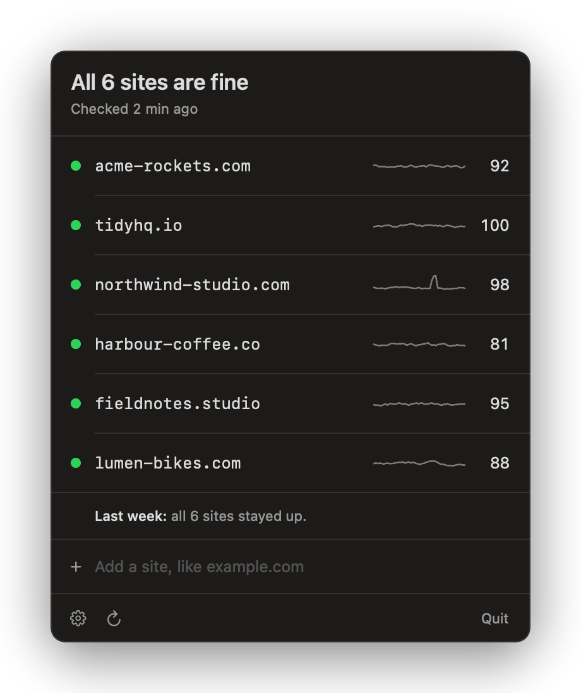
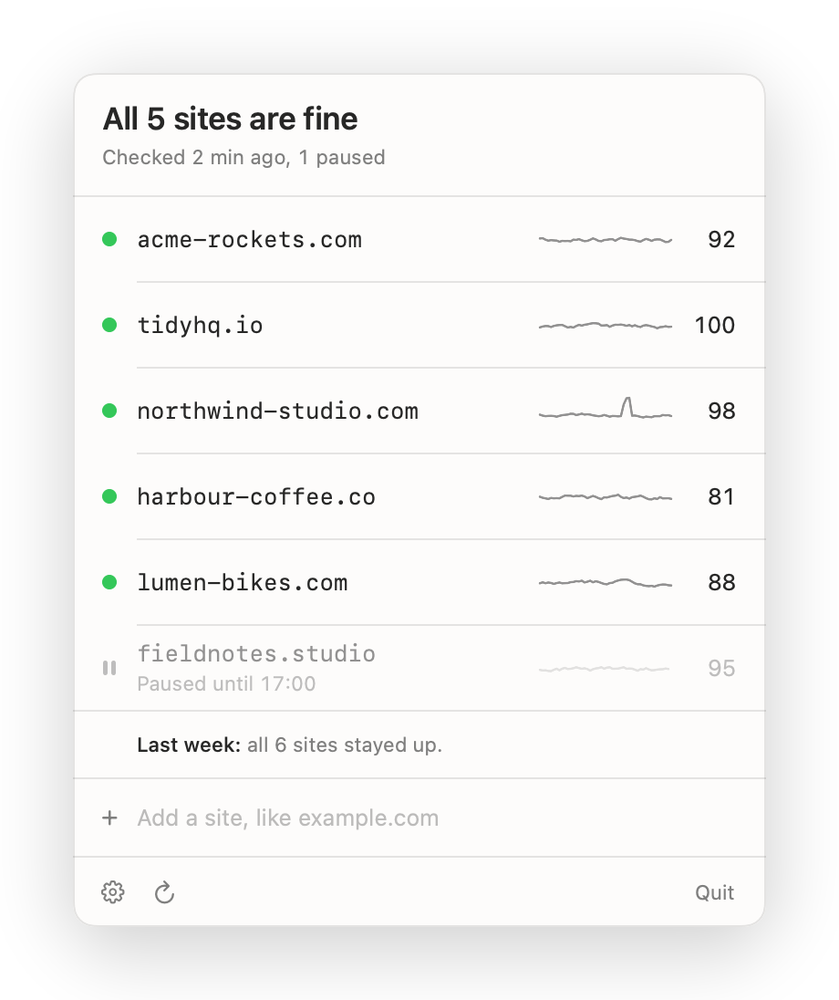
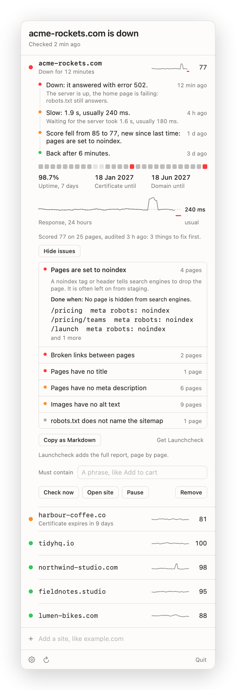
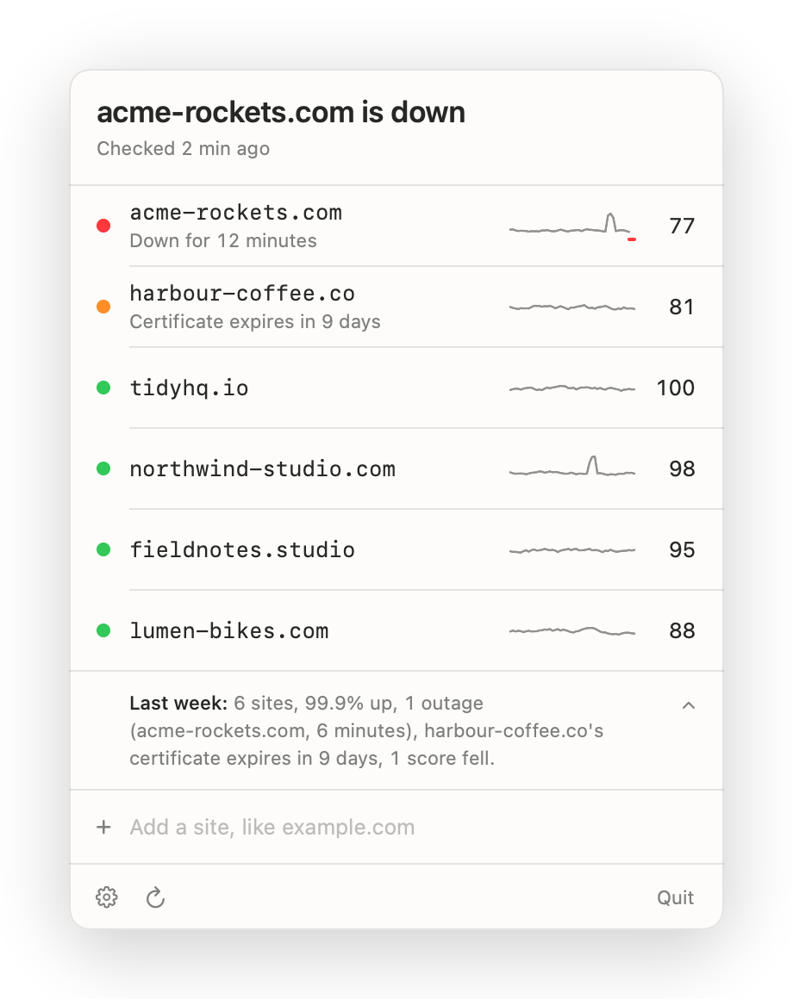

<p align="center">
  
</p>

<h1 align="center">Launchwatch</h1>

<p align="center">
  Keeps an eye on the sites you have already launched, from the menu bar.<br>
  Says nothing while they are fine. Tells you when one breaks.
</p>

<p align="center">
  <a href="https://github.com/brijraj-rana/launchwatch/actions/workflows/ci.yml"></a>
  
  
  
</p>

<p align="center">
  
</p>

## What it does

[Launchcheck](https://github.com/brijraj-rana/launchcheck) audits a site once, before it goes live. Launchwatch is what happens after: it keeps checking the sites that are already live, and speaks up when one of them stops being fine.

- **Is it up?** One request to the home page every five minutes. Two failures in a row before anything is called down, so a dropped request alarms nobody. A failed check is tried again 30 seconds later.
- **Is it slow?** Slow means slow for that site: three times its own median over the last day, twice in a row. There is no fixed number.
- **Is the certificate about to run out?** A warning at 14 days, another at 3, and one when it has expired.
- **Has it drifted?** Every six hours the Launchcheck engine reads up to 25 pages and compares them with last time. You hear about a noindex that appeared, a robots.txt that started blocking everything, a sitemap that disappeared, a home page title or canonical that changed, a new problem that would have stopped the launch, and a score that fell by five or more, with what caused it.
- **Why, not only what.** The moment a site is confirmed down, slow or missing its phrase, Launchwatch works out the likely cause and says it in one sentence, in the notification, in the row and in the channel: "The certificate ran out on 12 Nov 2026." "Cloudflare is up but the server behind it did not answer in time (error 522)." "The server is up, the home page is failing: robots.txt still answers." "Waiting for the server took 1.6 s, usually 180 ms." A guess is called likely, and when nothing explains it, nothing is added. See [what it can name](#the-likely-cause).
- **Is the domain about to run out?** Once a day the registry is asked when the registration ends. A warning at 30 days, another at 7, and one when it has expired. The date sits in the open row beside the certificate's.
- **Does the page still say what it should?** Give a site a phrase, like "Add to cart", and its home page must contain it. Missing twice in a row, it is reported: "lumen-bikes.com is up but missing “Add to cart”." This catches the site that answers 200 with an error page. Its return is reported too.
- **Pause a site.** For an hour, until 9:00 tomorrow, or until you resume it. A paused site is not checked, raises nothing, sits dimmed at the bottom of the list, is left out of the headline and the menu bar dot, and its paused time is left out of its uptime.
- **Tell a channel.** Paste a Slack or Discord incoming webhook, or any address that takes JSON, and every event is posted there as well.
- **Once, not forever.** Each of these is said one time, when it starts. It is not repeated while nothing has changed.
- **Not fooled by your own Wi-Fi.** When the Mac itself is offline, checks pause and no site is marked down.
- **The week in one sentence.** On Monday at 9:00, or the first time the Mac is awake after that, one notification sums up the last seven days: "Last week: 6 sites, 99.9% up, 1 outage (acme-rockets.com, 12 minutes), harbour-coffee.co's certificate expires in 9 days, 1 score fell." When nothing happened it says so: "Last week: all 6 sites stayed up." It is sent once a week and never twice, and stays in the panel until the next one.
- **What the audit found, in the panel.** See issues opens the list in the row itself: most serious first, each with how many pages, and on a click why it matters, when it counts as done and the first few addresses. Copy as Markdown puts the whole list on the clipboard for a ticket or a client.

Launchwatch works on its own. It runs the audit itself and shows what it found; nothing in it needs another app. [Launchcheck](https://github.com/brijraj-rana/launchcheck) adds the full report, page by page: with it installed, an open row gains Open report beside See issues. Without it, the issues view mentions once, quietly, where to get it, and nothing else in the app does.

<p align="center">
  
</p>

## Install

### Download

Get `Launchwatch-x.y.z.dmg` from the [latest release](https://github.com/brijraj-rana/launchwatch/releases/latest), open it and drag Launchwatch to Applications. It runs on Apple Silicon and Intel, macOS 14 or later.

The app is not notarized, so macOS blocks the first launch. Either allow it under System Settings → Privacy & Security → Open Anyway, or run:

```bash
xattr -dr com.apple.quarantine /Applications/Launchwatch.app
```

### Build from source

Requires Xcode 16 or later (for the Swift toolchain). The audit engine is fetched from the [Launchcheck](https://github.com/brijraj-rana/launchcheck) repository as a package.

```bash
git clone https://github.com/brijraj-rana/launchwatch.git
cd launchwatch
./scripts/build-app.sh --install   # builds, copies Launchwatch.app to /Applications, launches it
```

## Using it

| Do this | To |
|---|---|
| Click the menu bar icon | Open the panel |
| Type an address, press Return | Watch a site. It is checked once first, and not added if it does not answer |
| Click a row, or press Return on it | See recent events with their likely cause, the last seven days as a strip, uptime, the certificate and domain dates and the last day of response times |
| Rest the pointer on a square in the strip | See which six hours it stands for and how they went |
| Click See issues in an open row | Read what the last audit found, most serious first. Click one for why, when it is done and where |
| Click Copy as Markdown under the issues | Put the whole list on the clipboard |
| Click Open report in an open row | Open the full report for that site in Launchcheck, when Launchcheck is installed |
| Type a phrase after Must contain, press Return | Have the home page checked for that phrase at every pulse. Empty the field to stop |
| Click Pause in an open row | Choose 1 hour, Until tomorrow or Until resumed. Resume takes its place |
| Click the Last week line, when it is cut short | Read the whole summary |
| ↑ and ↓ | Move through the sites |
| ⌘R | Check every site now |
| ⌘N | Jump to the address field |
| ⌘, | Show or hide the settings |
| Esc | Close the panel |
| ⌘Q | Quit |
| Right-click a row | Check Now, Pause or Resume, Open Site, Open Report in Launchcheck, Copy Address, Remove |
| Right-click the menu bar icon | Check Now, Quit |

The menu bar icon is plain while everything is fine. It gains an amber or red dot when a site needs a look, and a number only when more than one does. Paused sites never count.

Settings are in the panel, behind the gear: how often to check uptime (1, 5 or 15 minutes), how often to run the audit (1, 6 or 24 hours), notifications, the weekly summary, watching domain expiry, opening at login, and the webhook. With the weekly summary off, nothing is written and the line leaves the panel. With notifications off and the summary on, it is written to the panel without a notification.

The webhook is its own switch: with an address in the field every event and the weekly summary are posted there, whether or not notifications are on, and with the field empty no request is ever made. An address at hooks.slack.com gets `{"text": ...}`, a Discord webhook gets `{"content": ...}` with mentions switched off, and any other address gets plain JSON: `text`, `site`, `kind`, `level`, `date`, `cause` and `source`. Send test posts one message so you can see it arrive. A message that cannot be delivered is not tried again and holds nothing up; the line under the field says what went wrong until one gets through.

<p align="center">
  
</p>

<p align="center">
  
</p>

<p align="center">
  
</p>

### The likely cause

What a diagnosis can say, tried in this order, stopping at the first that explains the event:

| Event | Cause it can name | Read from |
|---|---|---|
| Down | The name does not resolve, and the registration lapsed if the registry's date is known and past | The request's error, the stored domain date |
| Down | The certificate has run out, is not valid yet, is for another name, or is not signed by a trusted authority | The certificate the server presented |
| Down | The connection was refused, timed out, or was cut | The request's error |
| Down | Cloudflare is up and cannot reach the server behind it (errors 520 to 526 and 530), or the error page is Cloudflare's own | `cf-ray` and `server` headers, marks in the page |
| Down | The error is Vercel's, Netlify's, Webflow's or GitHub Pages' rather than the site's | `x-vercel-error`, `x-vercel-id`, `x-nf-request-id`, `x-github-request-id`, `x-wf-` headers, `server`, marks in the page |
| Down | It redirects in a loop, or to another domain that answers with an error | Where the request ended up |
| Down | The server is up and only the home page is failing | Two extra requests, see below |
| Down | What the error code usually means: 500, 502, 503, 504, 401, 403, 404, 429 | The status |
| Slow | Which part of the request grew against that site's usual: looking up the name, connecting, the secure handshake, waiting for the server, downloading the page | `URLSessionTaskMetrics` of the same request, and the day of stored timings |
| Missing phrase | Where the home page now redirects, or what its title is now | The same answer |
| Title or canonical changed | What it was before | The audit before |

The platform marks are the ones those platforms are known to send; they were written from documentation and memory and tested against invented samples, not against live error pages. Timings by phase are stored from 0.3.0 on, so for the first day a slow event names only the phase that took most of the time. The download is timed only for a site with a phrase to look for, since that is the only time the whole page is read.

<p align="center">
  
</p>

## Design notes

- **A verdict, then the evidence.** The largest text in the panel is one sentence that answers "is everything all right?". The list underneath is for when it is not.
- **Color means severity and nothing else.** Red, amber and green, in dots eight points wide. Everything else is the system's text colors and hairlines, so light, dark and Increase Contrast all work.
- **A site that is down is the headline.** Trouble sorts to the top, and one outage outranks any number of smaller worries.
- **Quiet by default.** A row shows a second line only when there is something to say. A score that has not been measured yet is an empty ring, not a zero.
- **Sparklines that mean something.** The top of each chart is twice that site's usual time, so a steady site draws a calm line through the middle and only a real spike reaches the top. Outages sit on the floor in red. Where nothing was measured, the line breaks.
- **A week you can see.** The open row shows the last seven days as 28 squares, four a day, the same squares as the page map in Launchcheck. Grey where the site was up, red where it was down, paler where nothing was checked because the Mac was asleep or the site was not watched yet. Down means what it means everywhere else here: two failures in a row, not one dropped request.
- **Last week stays out of the way.** The summary is one grey line under the list, not under the headline, because the headline is about now. A quiet week fits on the line. A longer one is cut short and opens when clicked.
- **A day you can read.** The open row draws the last 24 hours of response times in the row's own sparkline style, wider, with a dashed line at the usual time and the figure beside it. Nothing is fetched for it.
- **A pause is not a verdict.** A paused site gets two small bars, not a color, and half the ink.
- **Numbers that hold still.** Every figure uses tabular digits. Addresses are in SF Mono; nothing else is.
- **Motion with a reason.** Rows open in 200 ms and close faster. Buttons dip when pressed. Nothing animates from the keyboard, nothing loops except one small arc while a check is running, and all of it stops for Reduce Motion.
- **Plain words.** "acme-rockets.com is down: the server refused the connection." No codes unless the server sent one.

## How it is built

```
Sources/
  LaunchwatchCore/   UI-free watcher: pulses, audits, event detection, scheduling, the files it keeps
  Launchwatch/       the menu bar item, the panel, notifications, snapshot rendering
Tests/               event detection, de-duplication, scheduling, pausing, domain expiry and RDAP parsing, must contain, webhook payloads, the response chart,
                     every branch of the diagnosis, the issue list and its Markdown, the weekly summary, the uptime strip, old files still loading, the watcher end to end with stubs
scripts/             build-app.sh bundles the app and the DMG; make-icon.swift draws the icon in code
```

Where each reading comes from:

| Reading | Source |
|---|---|
| Up or down, response time | One `URLSession` request to the home page on a fresh connection, timed to the first byte of the answer |
| Certificate expiry | The leaf certificate from the server trust, read in the session's authentication challenge |
| Score and drift | `Auditor` and `Drift.compare` from LaunchcheckCore, on 25 pages, without external links or image weighing |
| Domain expiry | One GET a day to `https://rdap.org/domain/<domain>`, which redirects to the registry; the `expiration` event in its RDAP JSON |
| Must contain | The same request to the home page, read to the end (up to 2 MB) and searched for the phrase, ignoring case, spacing, tags and common entities |
| Likely cause | The same request: its error, status, headers, the first 16 KB of an error page, and `URLSessionTaskMetrics`. For an outage that might be the home page alone, `/robots.txt` and `/favicon.ico` once |
| Response chart | The stored pulse samples of the last day in quarter hours, nothing fetched |
| Issues | The latest audit report kept on disk, grouped by check with `Report.groups` from LaunchcheckCore |
| Offline | `NWPathMonitor`, plus the error a request gives when there is no connection |
| Uptime strip and weekly summary | The week of stored pulse samples and the event log, nothing fetched |
| Open report | `launchcheck://open?site=example.com`, offered only when `NSWorkspace` finds an app for that scheme |

Event detection, the diagnosis, scheduling, pausing, the weekly summary and the uptime strip are pure functions: state and a reading go in, a new state and any events come out, and the clock and the calendar are arguments. The tests never touch the network.

Sites, events and settings live in `~/Library/Application Support/Launchwatch`, along with a week of pulse samples and the latest audit report for each site. Files written by earlier versions still load.

### Privacy

There is no account, no analytics and no server of Launchwatch's own. These are all the requests it makes:

| Request | To | When |
|---|---|---|
| The pulse | The home page of each site you added | Every 1, 5 or 15 minutes, and 30 seconds after a failure or a missing phrase |
| The audit | Up to 25 pages of each site, its robots.txt and sitemap | Every 1, 6 or 24 hours |
| The diagnosis | `/robots.txt` and `/favicon.ico` on the same site: at most two short requests | Once, at the moment a site is confirmed down with an error or a timeout that might be the home page alone. Never while a site is fine |
| Domain expiry | `https://rdap.org/domain/<domain>`, which redirects to the registry for that ending. This sends the domain name, and nothing else, to rdap.org and to that registry | Once a day for each site, unless Watch domain expiry is off |
| The webhook | The address you entered, with the event's text, site, kind and time | For each event, and only if you entered an address. Never otherwise |
| Get Launchcheck | Opens a GitHub page in your browser | Only when you click it |

Everything else, the response chart, the uptime strip, the weekly summary and the issue list among them, is worked out from what is already on your Mac.

### Developing

```bash
swift build && swift test       # or open Package.swift in Xcode
./scripts/build-app.sh --open   # build and launch the app bundle
./scripts/build-app.sh --dmg    # universal build, packaged as build/Launchwatch-<version>.dmg
.build/debug/Launchwatch --snapshot docs        # re-render the README screenshots with sample data
.build/debug/Launchwatch --pulse example.com    # one real pulse, printed
.build/debug/Launchwatch --summary              # what the weekly summary would say right now
LAUNCHWATCH_HOME=/tmp/lw .build/debug/Launchwatch   # run against a scratch data folder
```

## License

[MIT](LICENSE)
