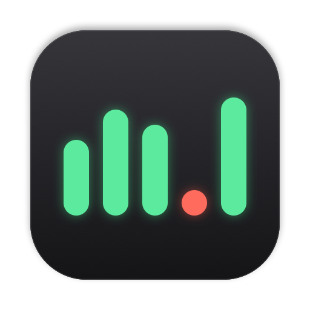
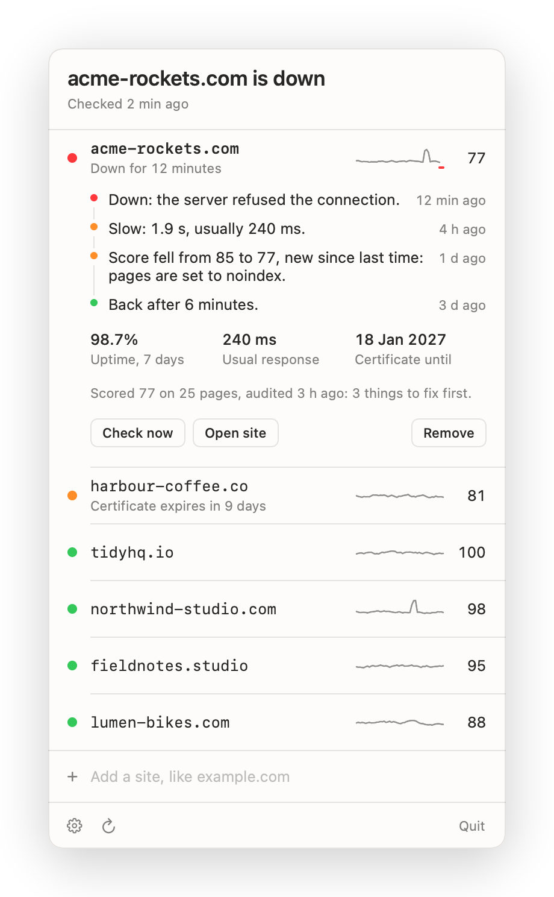
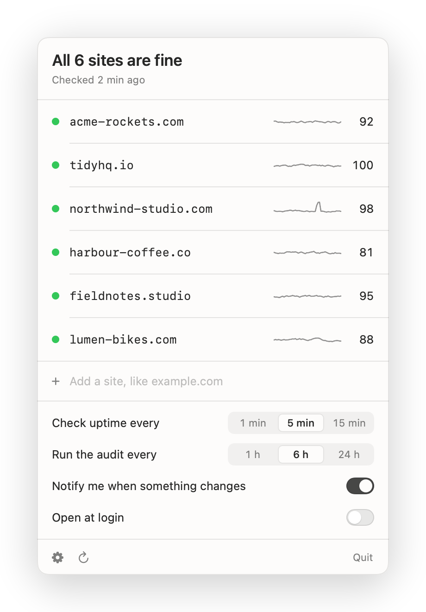

<p align="center">
  
</p>

<h1 align="center">Launchwatch</h1>

<p align="center">
  Keeps an eye on the sites you have already launched, from the menu bar.<br>
  Says nothing while they are fine. Tells you when one breaks.
</p>

<p align="center">
  <a href="https://github.com/BRIJRAJ-02/launchwatch/actions/workflows/ci.yml"></a>
  
  
  
</p>

<p align="center">
  
</p>

## What it does

[Launchcheck](https://github.com/BRIJRAJ-02/launchcheck) audits a site once, before it goes live. Launchwatch is what happens after: it keeps checking the sites that are already live, and speaks up when one of them stops being fine.

- **Is it up?** One request to the home page every five minutes. Two failures in a row before anything is called down, so a dropped request alarms nobody. A failed check is tried again 30 seconds later.
- **Is it slow?** Slow means slow for that site: three times its own median over the last day, twice in a row. There is no fixed number.
- **Is the certificate about to run out?** A warning at 14 days, another at 3, and one when it has expired.
- **Has it drifted?** Every six hours the Launchcheck engine reads up to 25 pages and compares them with last time. You hear about a noindex that appeared, a robots.txt that started blocking everything, a sitemap that disappeared, a home page title or canonical that changed, a new problem that would have stopped the launch, and a score that fell by five or more, with what caused it.
- **Once, not forever.** Each of these is said one time, when it starts. It is not repeated while nothing has changed.
- **Not fooled by your own Wi-Fi.** When the Mac itself is offline, checks pause and no site is marked down.

<p align="center">
  
</p>

## Install

### Download

Get `Launchwatch-x.y.z.dmg` from the [latest release](https://github.com/BRIJRAJ-02/launchwatch/releases/latest), open it and drag Launchwatch to Applications. It runs on Apple Silicon and Intel, macOS 14 or later.

The app is not notarized, so macOS blocks the first launch. Either allow it under System Settings → Privacy & Security → Open Anyway, or run:

```bash
xattr -dr com.apple.quarantine /Applications/Launchwatch.app
```

### Build from source

Requires Xcode 16 or later (for the Swift toolchain). The audit engine is fetched from the [Launchcheck](https://github.com/BRIJRAJ-02/launchcheck) repository as a package.

```bash
git clone https://github.com/BRIJRAJ-02/launchwatch.git
cd launchwatch
./scripts/build-app.sh --install   # builds, copies Launchwatch.app to /Applications, launches it
```

## Using it

| Do this | To |
|---|---|
| Click the menu bar icon | Open the panel |
| Type an address, press Return | Watch a site. It is checked once first, and not added if it does not answer |
| Click a row, or press Return on it | See recent events, uptime, usual response time and the certificate date |
| ↑ and ↓ | Move through the sites |
| ⌘R | Check every site now |
| ⌘N | Jump to the address field |
| ⌘, | Show or hide the settings |
| Esc | Close the panel |
| ⌘Q | Quit |
| Right-click a row | Check Now, Open Site, Copy Address, Remove |
| Right-click the menu bar icon | Check Now, Quit |

The menu bar icon is plain while everything is fine. It gains an amber or red dot when a site needs a look, and a number only when more than one does.

Settings are in the panel, behind the gear: how often to check uptime (1, 5 or 15 minutes), how often to run the audit (1, 6 or 24 hours), notifications, and opening at login.

<p align="center">
  
</p>

## Design notes

- **A verdict, then the evidence.** The largest text in the panel is one sentence that answers "is everything all right?". The list underneath is for when it is not.
- **Color means severity and nothing else.** Red, amber and green, in dots eight points wide. Everything else is the system's text colors and hairlines, so light, dark and Increase Contrast all work.
- **A site that is down is the headline.** Trouble sorts to the top, and one outage outranks any number of smaller worries.
- **Quiet by default.** A row shows a second line only when there is something to say. A score that has not been measured yet is an empty ring, not a zero.
- **Sparklines that mean something.** The top of each chart is twice that site's usual time, so a steady site draws a calm line through the middle and only a real spike reaches the top. Outages sit on the floor in red. Where nothing was measured, the line breaks.
- **Numbers that hold still.** Every figure uses tabular digits. Addresses are in SF Mono; nothing else is.
- **Motion with a reason.** Rows open in 200 ms and close faster. Buttons dip when pressed. Nothing animates from the keyboard, nothing loops except one small arc while a check is running, and all of it stops for Reduce Motion.
- **Plain words.** "acme-rockets.com is down: the server refused the connection." No codes unless the server sent one.

## How it is built

```
Sources/
  LaunchwatchCore/   UI-free watcher: pulses, audits, event detection, scheduling, the files it keeps
  Launchwatch/       the menu bar item, the panel, notifications, snapshot rendering
Tests/               event detection, de-duplication, scheduling, persistence, the watcher end to end with stubs
scripts/             build-app.sh bundles the app and the DMG; make-icon.swift draws the icon in code
```

Where each reading comes from:

| Reading | Source |
|---|---|
| Up or down, response time | One `URLSession` request to the home page on a fresh connection, timed to the first byte of the answer |
| Certificate expiry | The leaf certificate from the server trust, read in the session's authentication challenge |
| Score and drift | `Auditor` and `Drift.compare` from LaunchcheckCore, on 25 pages, without external links or image weighing |
| Offline | `NWPathMonitor`, plus the error a request gives when there is no connection |

Event detection and scheduling are pure functions: state and a reading go in, a new state and any events come out, and the clock is an argument. The tests never touch the network.

Sites, events and settings live in `~/Library/Application Support/Launchwatch`, along with a week of pulse samples and the latest audit report for each site. Nothing leaves your Mac except the requests to the sites you added.

### Developing

```bash
swift build && swift test       # or open Package.swift in Xcode
./scripts/build-app.sh --open   # build and launch the app bundle
./scripts/build-app.sh --dmg    # universal build, packaged as build/Launchwatch-<version>.dmg
.build/debug/Launchwatch --snapshot docs        # re-render the README screenshots with sample data
.build/debug/Launchwatch --pulse example.com    # one real pulse, printed
LAUNCHWATCH_HOME=/tmp/lw .build/debug/Launchwatch   # run against a scratch data folder
```

## License

[MIT](LICENSE)
